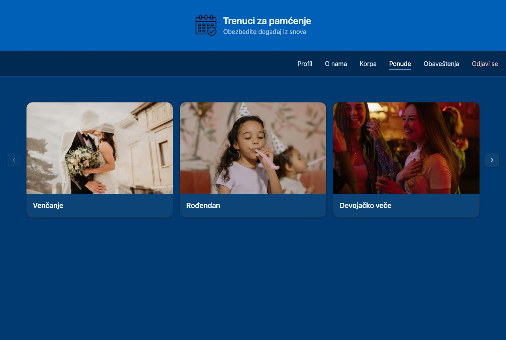
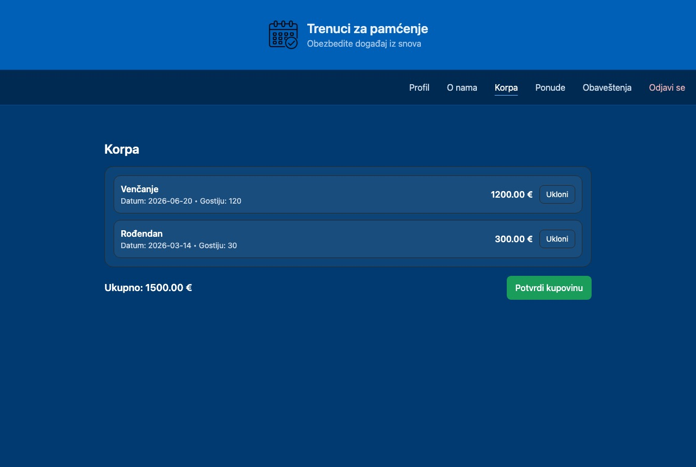
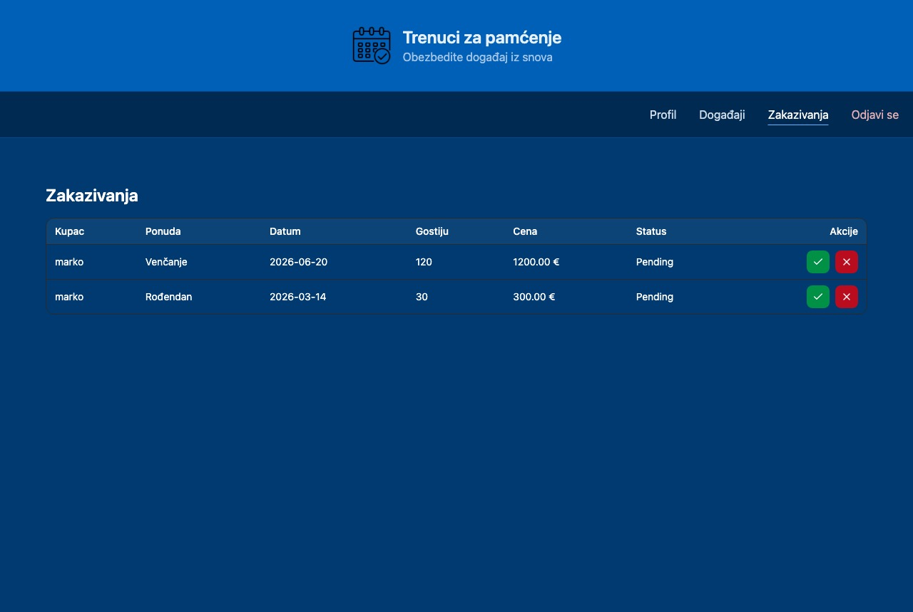
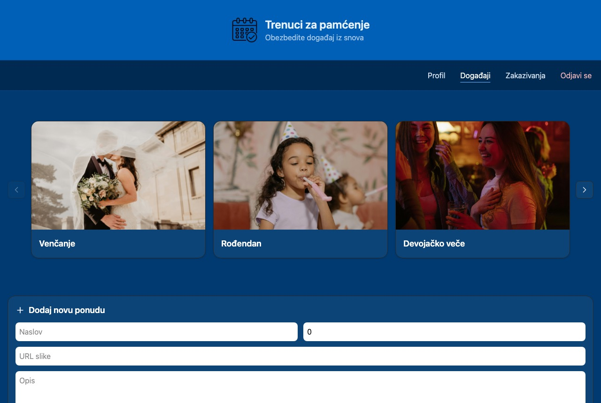
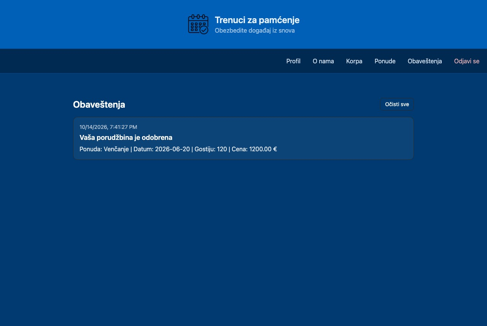
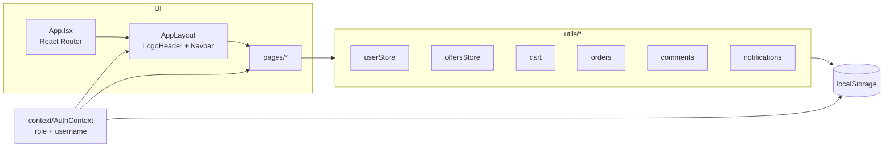

# Moments to Remember (web)

[](https://github.com/djokerg/moments-to-remember-web/actions/workflows/ci.yml)
[](https://github.com/djokerg/moments-to-remember-web/actions/workflows/deploy.yml)

A web app for an event-planning agency: customers browse packages (weddings, birthdays,
graduations…), book a date and leave reviews, and the organizer approves bookings and manages
the catalog. Built with React 19, TypeScript, Vite and Tailwind CSS.

**Live demo: https://djokerg.github.io/moments-to-remember-web/**

The UI is in Serbian (the app is called *Trenuci za pamćenje*). There is also a
[React Native version](https://github.com/djokerg/moments-to-remember-mobile) of the same app.


## Try it

Register any account to book as a customer, or log in as the organizer:

| Username | Password | Role |
|---|---|---|
| `organizator` | `admin` | Organizer (approves bookings, edits offers) |

All data lives in your browser's `localStorage`, so nothing you enter leaves your machine.
Clear the site data to start over.

## Quick start

Requires Node.js 20.19+ or 22.12+.

```bash
npm ci
npm run dev       # http://localhost:5173
npm run build     # type-check and production build into dist/
```

## Features

**Customers**
- Register, log in, edit profile and change password
- Browse offers in a paged gallery, open an offer, pick a date and number of guests
- Cart with total and checkout, which turns each item into a pending booking
- Rate and comment on offers (1 to 5 stars)
- Notifications when the organizer approves a booking

**Organizer**
- Review pending bookings and approve or deny them
- Add new offers and edit existing ones (title, price, image URL, description)

| Offers | Offer detail and booking |
|---|---|
|  |  |

| Cart | Organizer: pending bookings |
|---|---|
|  |  |

| Organizer: manage offers | Customer notification after approval |
|---|---|
|  |  |

## Architecture

There is no backend. Pages talk to a set of small storage modules, each owning one
`localStorage` key, which act as a stand-in for an API.



## How it works

- **Storage modules instead of an API.** Each file in [`src/utils/`](src/utils) wraps one
  `localStorage` key with a private `read`/`write` pair and exports typed operations
  (`createOrder`, `setOrderStatus`, `addComment`…). Pages never touch `localStorage` directly,
  so replacing a module with HTTP calls would not change the pages.
- **Roles.** [`AuthContext`](src/context/AuthContext.tsx) keeps `{ role, username }` and persists
  it across reloads. [`LoginPage`](src/pages/LoginPage.tsx) checks the password against
  [`userStore`](src/utils/userStore.ts) and logs in as `admin` when the username is the seeded
  organizer account. [`Navbar`](src/components/Navbar.tsx) shows a different menu for guests,
  customers and the organizer.
- **One page, two modes.** [`OfferDetailPage`](src/pages/OfferDetailPage.tsx) serves both
  `/offers/:id` and `/events/:id`. Customers get the booking form; the organizer on `/events/:id`
  gets an edit form instead. The built-in offers are copied into storage on first load
  ([`offersStore`](src/utils/offersStore.ts)) so the organizer's edits persist.
- **Booking lifecycle.** Cart items become `pending` orders at checkout
  ([`CartPage`](src/pages/CartPage.tsx)). When the organizer approves one in
  [`BookingsPage`](src/pages/BookingsPage.tsx), a notification is written for that customer and
  shows up on their notifications page.

## Routes

| Path | Page | Who |
|---|---|---|
| `/` | Home with carousel | Everyone |
| `/login`, `/register` | Login, registration | Guests |
| `/offers`, `/offers/:id` | Offer gallery, booking and comments | Customers |
| `/cart` | Cart and checkout | Customers |
| `/notifications` | Booking notifications | Customers |
| `/about-us` | Contact details | Customers |
| `/profile` | Profile and password | Logged in |
| `/events`, `/events/:id` | Manage offers | Organizer |
| `/bookings` | Approve or deny bookings | Organizer |

## Project layout

```
src/
  App.tsx            routes
  context/           AuthContext (role and session)
  components/        layout, navbar, carousel, offer card
  pages/             one file per route
  utils/             localStorage-backed stores
  assets/            images
docs/screenshots/    README images
```

## Limitations

- No server: data is per browser and per device, and every visitor has their own copy.
- Passwords are stored in plain text in `localStorage`. Fine for a demo, never for real users.
- The organizer account is hard-coded.
- UI text is Serbian only.

## Credits

Built by Djordje Grebovic in 2025 as a project for the *User Application Programming* course at
the University of Belgrade. All code, design and content are the author's own.
